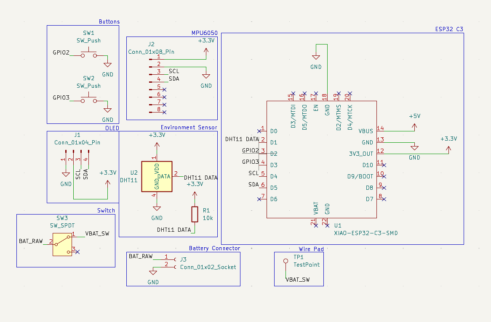
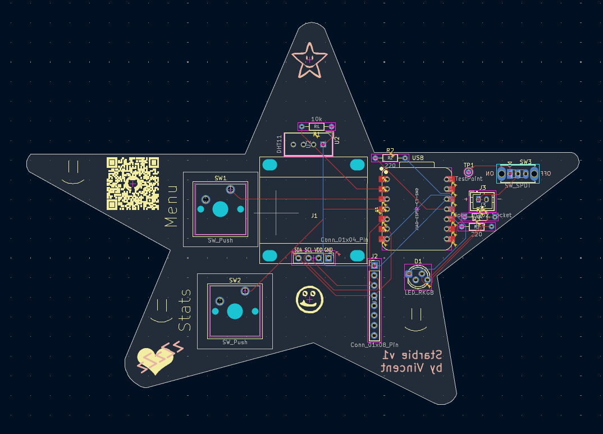

# Starbie

## Overview

Starbie is a tiny motion controlled desktop pet, powered by USB or battery. It is a star-shaped PCB hosting a little digital creature on an OLED Screen. It includes multiple interactive functionalities. Tilt it to navigate menus, shake it to wake it up, and watch its mood light change as you neglect it. (you probably shouldn't neglect it but this is also a functionality, not a recommendation.) Also has multiple sensors that track gyroscopic and accelerometric position, as well as tracking temperature and humidity.

This project was built for Hack Club's hardware program [Half Life](https://halflife.hackclub.com/), a 10 week YSWS to help beginners learn hardware project, and incidentally, it is ***my*** first hardware project!!! :DDD

I will also note that this is based off a tutorial from one of Half Life's organisers, and you can find the tutorial repo [here](https://github.com/SharKingStudios/Starbie). I added some additional features myself, but thank you [SharKingStudios](https://github.com/SharKingStudios/) this tutorial as it was a great starting point.

## Schematic, PCB and Components

The final schematic is shown in the above picture, featuring a XIAO-ESP32-C3, Environment and MPU6050 sensor, as well as a menu button and an on/off switch as well as a battery connector. 

The desktop pet can be powered both by battery or by USB connection

## Features

- **Wandering pet:** a 32×32 pixel creature walks across the OLED.
- **Tilt-controlled radial menu:** press the menu button, then tilt to pick an option, and press again to select the option. The interactive options are:
- --> **Nap:** Starbie just falls asleep with zzz's until you shake it to wake it up
- --> **Play:** Starbie sprints in laps with hearts
- --> **Feed:** Starbie wiggles and jumps and gains fullness
- --> **Pet:** Increases Starbie's joy
- **Stats:** Joy, Energy, and Fullness, saved to flash so they save when you turn Starbie back on
- **Shake to wake:** shaking it wakes it and gets a reaction
- **Environment sensing:** Starbie can detect the temperature (and it **will** complain if it's too hot or cold!)
- **RGB Mood Light**: this shows how starbie is feeling:
Dark blue: napping
Pink: being loved
Red: too hot!
ice blue: too cold!
amber: hungry or tired
green: happy (brighter = morer happierness)
purple: dizzy

## Hardware

Full list in [`BOM.csv`](Starbie/BOM.csv). Gerbers in [`gerbers/`](Starbie/gerbers/).

## Firmware

Arduino IDE was used to program Starbie. 

## AI Usage

AI was not used in any way for this project besides as a guide to help me learn to use KiCad